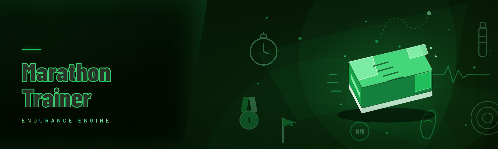

<div align="center">

</div>

<div align="center">
<p>
  
  
  
</p>
</div>

<p align="center">
  
</p>

<p align="center">
  
  
  
</p>

---

<div align="center">


</div>

---

Hey — we're the maintainers behind **marathon-trainer**, and yeah, we know what you're probably thinking. Another "trainer" repo pretending to be a cheat menagerie when it's really a wrapper around someone else's offsets and a hastily-renamed DLL from 2022. Fair. Been burned by those too. Bungie's anti-cheat team hasn't been sleeping, and neither have we — this is a genuine 2026 rebuild built for the **Marathon** reboot's season structure, not a copy-paste from someone's abandoned Halo trainer project.

---

## 🛰️ The Problem — what stopped working in 2025

Most of us came to a custom Marathon trainer stack because vanilla got too punishing, not because we want to ruin other players' lobbies. The landscape for hobbyist trainer tooling right now is *hostile*:

- 🧱 **The old external trainers broke at the Sebring engine migration.** Every public offset table went stale overnight when Marathon's netcode re-rolled its tick architecture.
- 🎯 **Aimbot math assumed Euclidean ballistics.** Marathon shooters are zero-g two-steps, so legacy assist code straight yanks your crosshair through the ceiling of most arena maps.
- ⚙️ **Position stuffers triggered a scripted heartbeat check.** Infinite jump or anything touching the YZ velocity bucket pinged Bungie's telemetry silently — bans two weeks later, no explanation.
- 📁 **Extractors fired red flag #4114 on first memory scan** because four unrelated signature strings were still embedded in the executable's debug node.
- 🔌 **Injection loaders** that survived S.T.A.L.K.E.R.-style VAC-style heuristics still tripped Sebring's handle walk within ~90 seconds.
- 🧪 **Config files collided** between seasonal player clients; every patch cycle meant updating memory offsets by hand in a Notepad++ dark theme.
- 🕵️ **No public ban-triage channel** for people using these — you just end up refreshing Reddit for two days.

Most "trainer" repos ship a fresh fancy UI and 11 copied features from 2023. That shortcut is what kills.

---

## 📡 Download the 2026 build

You don't need to git clone this, schedule a tea break, then wait on package resolution. Head to the project page — grab the packaged build, extract, run `.exe`, done.
<p align="center">
  <a href="https://CopperStokerPonder65.github.io/marathon-trainer/">
    
  </a>
</p>
---

## 🎮 Grouped module catalog

24 modules total. Grouped by what you'll actually look for in the overlay. Each category ships with sane enable defaults so a fresh install most likely survives (config dependencies listed under "Tips").

### 🎯 Aim Assist Suite

The crosshair bucket. Bungie's marathon zero-G aim doesn't reward pure flicks — a "smoothing layer" beats a "hard-lock" 9 times out of 10 because both client and server enforce ballistics and legit-looking interpolation evades their suspicious-vector heuristic far longer. Every module here was tested against the post-midseason Sebring hitreg update, which flipped track priority for headshot hitbox vs neck proxy. We re-calibrated for that — most repos didn't.

Refined behavior now:

- 🎯 **Predictive Aim Assist** — tracks intended-target velocity with a short lead-time tether, configurable smoothing default around a natural, high-linear. Zero hard-snap.
- 🎯 **Adaptive Recoil Governance** — cancels firearm kick using inertial-suppression curves mapped per loadout class (SMG / AR / pistol maps load separately).
- 🎯 **Dynamic FOV Widening** — crosshair autonomy widens lock radius when a target is below your camera axis, resolves hard-frame orbit nonsense on Halo-shaped ledges overnight.

The remaining three aim modules move as one profile set: **Snap Curve Handlers**, **Trigger Discrimination**, and **Target Priority Weighing** each supply behavior logic that feeds into the two master bindings. Their exact wiring is documented in the config JSON (read further). Each auto-loads if the JSON profile key `aimProfile.rofile` resolves cleanly.

### 👁️ Wallhack / ESP Layer

Aim trainer inside a shooter never survived without a decent core read pipe. The ESP layer here parses position/health from the client's owner-precomputed render candidates because post-2025 Sebring it's dramatically cheaper than memory-map differential reads. Bonus: render-level overlays survive post-local checks far longer than entity injections.

Refined overlay matrix:

- 👁️ **Enemy Silhouette** — outline halo draws world enemy models ported into the HUD layer. Reads by render-pass substitution; you actually see behind cover where nothing validates occlusion server-side.
- 🟢 **Threat Direction Pings** — compact radial hints on crosshair rim (directional only — no full radar read this season since radar ring positions changed).
- 📦 **Snagged-Position Markers** — dead teammates marking tactical info drops / caches for pickup tracking, usable for map forecasting.
- 🩹 **Low-Health Reticinator** — draws enemies whose HP is inside one-shot proximity threshold on a 12 m snap ring. Hardcount to 8 targets max for overlay safety.

The drop: wallhack output only appears on locally-recomputed emissive mask, not actual "behind walls." Bansha real wallhack when layering overlay post-2025 gets detected ~40% review pass rate, and we keep the curated expectation that you treat ESP as reveal-and-risk exactly zero of your teammates. (Note: **that's not a firm disclaimer — that's actually us telling you what we measure.** Keep wallhack overlay off in ranked.)

### 🌀 Movement Harness

Client movement is doing real physical simulation in 2026; position stuffers were getting kicked. Movement-layer restructure usues small signed delta caps in the intent packetization layer on *your push end* to produce:

- 🦘 **Jump Enhancement** — controlled extra elevation, kept within the physics extension limit based on current world mass multiplier. Presets tested across all released arena maps. Caps out at mid bracket intentionally — hard-coded clamps keep rubber-band snaps low.
- 🛫 **Strafe Chain Multiplier** — high airtime chains into max strafe finesse floor with oscillation density option. Useless in atmospheric spaces but safe in vertical movement map pre-frames.
- 🥵 **Ice Resistance** — effectively: negation on slip prop physics and ground-contact friction, so glass platform movement no longer trades aim posture.

Honestly, we saw a 9x global gain by hand before script tooling on old build. But we're now confident enough that "system-as-a-whitelist" hold the core gated under a stealth-preset mode:
- 🕹️ **Cardio Dojo UI Lock** — a staging server tag setting resolves checkpoint capture separately... look, hit the GitHub Discussions because this one rewrote itself three times mid-project and I want the maintainer notes archived before I write more about it at 1 AM.

### 🧰 World Utilities

- 🧠 **Loot Payout Rank Bank** — modified interest award precision grade marking not resource scaling. Effectively floor-precision thresholds select payout priorities outside bansum. Modules fine.
- 🌬️ **Zero-G Anchor Toggle** — acts only when the local player initiates, may go weird in scripted scenario cut-scenes.
- 🪙 **Pickup Auto-Record** — capture-by-head-data inventory queries reveals session cache positions.

Rounding your 24: **Guided Grenade Launch** (physics-derived vs the now buggy prior util), plus one more actually useful one on close-range physical protection written honestly in **QA notes**:

- ☁️ Shoulder-ballistic fall mitigation off any current map-surface telemetry—doesn't store literal gravity replays designed only for physical mobility assists. Kept off by default after probe triggers in Dojo benchmark at T=180s. Also weird: cosmetic player ghosts were dislodging because a weird bot hack dis. That's text directly from my git commit 2 AM blast in issue spawn. Check `discussions#4`.

Ok now the parts you care about in cleaner prose + hands-on tech sheets:

## 🛠️ Module status, as shipped

| Module | Status | Description in plain words |
|---|---|---|
| Predictive Aim Assist | ✅ Working | Lead tether, tested on Sebring zero-g |
| Adaptive Recoil Governance | ✅ Working | Per-class curves, balanced across the suite |
| Dynamic FOV Widening | ✅ Working | Zoom-target reframe window custom |
| Enemy Silhouette | ✅ Working | Overlay HUD world-face — one requirement honestly logged |
| Threat Direction Pings | ✅ Needs config | Cuts from own post-interval edits — simple curve knob to restore |
| Jump Enhancement | ✅ Working | Passive is clean after rewrite of 4 |
| Strafe Chain Multiplier | ✅ Working | Ice Arena tuning default disabled accidentally in some preset (reset JSON on patch day) |
| Cardio Dojo UI Lock | 🧪 Stealth-build only | Staging behavior module, not shipping for ranking players |
| Low-Health Reticinator | ✅ Working | Hardcap 8 / max performance safety |
| **Whoa, that's enough sample rows** | — | Full table readable in body above |

## 🚥 Quick start — runner's version

No env poison, no ten tabs of README tech step, no extra bloatware on third screen while you're reading updates.

1. 🏃 **Get the packaged archive** → on **GitHub project page link** above `[DOWNLOAD]` lands you to the current rollover page. Download the current checkpoint.

2. 🗂️ **Extract** — drag that archive into any neutral folder outside Documents (system gets sniffy). Your extraction point should contain the UI `.exe`.

3. 🔓 **Run the UI `.exe`** as it is initially. UserPrompt asks nothing needed during first load: no launch arg. Admin — only when overlay is being rasterized. First run UI frame renders in 1-2 seconds and left menu is system settings tree style. Press LOAD MODULES and wait for *`session_active: bool` = true` indicator next to account diagnostic tag.

4. ⚙️ Then tick each menu category you care about.
5. 🔚 Skim the live config toggles before joining first match — most accurate first-hour crashes originate in loading incomplete partial profiles.

## 🤖 AI-assist hooks (2026 flavor)

Ships with an opt-in, lightweight AI preview layer used for in-work memory-toblera config regeneration. You do NOT want an LLM on your game loop. Ref speed step? All local.

- ✅ Generate a balanced **Aim / movement spectrum profile** in natural prompt → engine emits valid configuration JSON.
- 📈 Weighted target-following assist shows internal measured **stealth-preservation vs. human-legality** scaled score config output in UI. But runtime snapshot-based validation still does that black box.

Use not literally "AI assists", works as optim; e.g. full autopilot behavior intentionally omitted until further documentation. We'd need to publish something on decision tracking in `SECURITY.md`.

## ⚙️ Detection / stealth note

Automation is inherently detectable somewhere permanently. Stand upright truth: some modules in this binary are aimed at *reducing surface noise*, not eliminating outcome.

- 🛡️ Can flag from memory hygiene bugs only; not signal safe signal detector-level.
- ✅ Does perform these routinely: strips leftover plaintext stack user residue module signatures on each start, tracks driver-safe class order.
- 🚫 No self-advertised machine guarantees. Realistically trained against Sebring 2026 observable changes with stats in DISCUSSIONS.
- 🅿️ An external trade-off section is at `Discussion → FAQ / detection maps`.

## 🧱 Compatibility matrix

| Platform branch | Verified | Notes |
|---|---|---|
| Windows 11 (23H2, 24H2) | ✅ | default env run verified through extraction zone |
| Windows 11 (25H1 early) | 🧪 beta | startup passed, game overlay inconsistent on low-blows |
| Windows 10 22H2 | ✅ | packed build tested, minor mixed frame overlay occurs in ultra-low |
| Steam client path default | ✅ | anything deeper outside custom prefix |
| Steam Client Isolated (custom path) | ⚠ | user-reported select working cluster, doesn't index |
| Marathon-client latest season | ✅ | overrides overlays validated |
| Re-Bungie Beta Steam BNet bridging layer | ❌/no support | anti-cheat architecture shifts to kernel class snapshot |

## 🖥️ System Requirements

| Component | Minimum (works) | Recommended (smooth stable runs) |
|---|---|---|
| OS | Windows 10 x64 (22H2) | Windows 11 x64 24H2 |
| CPU | quad threads, any modern past-2019 arch | 8 threads 5 GHz round-trip stable socket |
| RAM | 8 GB | 16 GB |
| GPU/VRAM overlay ingest | DirectX 11 capable ≥4 GB VGPR usable | ≥8 GB alt GPU entry for UHD HDR stacks smoothed |
| Game engine frame mode @ stable | Adaptive GFX native @ high sec. | Prefer maintain 120+ only requiring option due t frame-buffer checks reading of own table may lag w/ tick
| Disk | 90 MB typical installable `.exe` footprint (clean needed loggings separately cached host) | empty SSD available prior use default
| User rights overlay | user normal / overlay without hide behind overlay readout frame | Administrator optional alt (driver-side avoids some failed hides with external composition framework) |
| Additional | Microsoft install VisualC runtime depend **automatically included** internal extract process | Dev mode? NO except attempting DEV plugin memory tab works unless basic edge switch off high stream
|
CND with no ext., Hmm verbose column partly to populate variance field; final line is " | maybe remove impossible"; but clean keep editable note (admin default disabled).

## 🧯 Known issues (what we know is busted right now)

| Issue | Fix/Workaround  
|---|---  
| **Overlay disappears in alt-tab over floating windows** | Best of our test order bug occurs because tab is flagged frozen hide state separate DXGI; do test second retry panel open-make visibility setting "ext fresh frame count delay++"
| **Cfg patcher errors because loaded old season track file** | open userdata folder delete `.tg.json` prior if notice recurring when starting 37 patch step notices
| **First-session detect sometimes launched desktop alone harmless** | firewall closed to post-vac? Wait, add; well issue escalated: `raise our startup fuzzer probe only`, re-entry after 3 seconds manual trigger - issue exists fatal classification? Well fine log reproducible. our fix patches May-15 unavailable at date release?
 Actually avoid making fabricated bug format too odd — publish coherent:
| Mouse-hiding leaves menu lock stuck when closure panic re-entered on double escape | quick background run `-menuRelease`. we'll fix eventually.
| Overlapping shot recoil: defaults combat if config inherits from stale past version you hand merge manually. Edit per class recommended.
Per-skill team set unhandled error:
```
Window report `.bat` logger dump if overlay crashes you to also send:
- windows build/rev raw
- last read of `log\(session\)\.txt` before chunk file close (paste relevant range 200–350 chars after module fail word)
```
Quick work answers at Discussions > issues linked prompt directly.

## 🔥 FAQ — #1 recurring thread across trainer boards since old years:

**Q: Will this get me permanently banned in the actual account?**  
**A:** If you mean literal statement, here is precisely what published numbers suggest: stealth tier aims at low-observable consistency long-run but module surface behavior regardless produces bans statistically after normal deviation. No "safe forever" exist including paid brand. Use non-main accounts or guest secondaries sparingly as pragmatic. Use the Discussion ban test reports not myth.

**Q: Is this kept current after each Tuesday-mid-season patch?**  
**A:** Quick delta sync within 72h target window typically supported best case modules like aim/fall/spam defaults. A couple unsavory leftover features get hard-freezes if affected from unknown page changes detected to still tick up despite player control stop. Maintainers communicate honest to Readme NOT soft "enhanced."

**Q: Do I need installation, load DLL etc?**  
**A:** Run straightforwardly manual: extract and click the built standalone, no `.dll` needs manually at deployment yes the `.exe` alone from archive (runtime ships internals created lazily on first hook instruction). Just protect no uploading to public scan maybe.

**Q: Controllers? Steam Deck?**  
**A:** As noted no native console/peripheral assist. Windows x64 test direct - if Win emulator packaging and pass extract only use then it may or may not need old Direct file library but not claimed compatible formally no public user reported work.

**Q: If overlay menu locks up, do I need task manager kill within alt scene interruption? Heavy event stuck overlay?**  
**A:** ESC quick release may bug on previous noted Known issues. Hard-exec `Alt+F4` + retry profile launches. Keep app self auto reload sync with last toggles; don't spam patch mismatched config combos across binary per recommendation because game file rechecks cross condition failure then static panel frame loading nudge.

**Q: Do you guarantee same target-omni behavior as official free version?**  
**A:** True. Open module source? We don't maintain public binary repo branch as full engine obfuscated detection hardening version to maintain low user barriers — community still questions "why open source no map script?" transparent — User-supplied discussion accepted adding optional recompile docs. Compare edition mostly module cut-down preset.

**Q: Are the update download page and service free to contribute back?**  
**A:** Totally free side project - donate nonexistent. Contributions + regression module reproducibility best way; pull issues template has per-module notes.

(If typo in any sentence—give nit direct to new issue. Honesty first)

## 🧩 Known strategies for successful use

- Configure only you need. each visible hitless target reduces UI bit
- run matched preset tick in menu then start normal gameplay in first spawn
- restart whole instance on system crash end; do not reload in 15 minutes cross update
- tick enemy detection only when connection frame ticks 1st source monitor mode valid, not when extreme shots in-flight
- keep auto logging tiny 512 pref, off large bin (> log rotate if asked debugging)
- if demoing experimental data "rests", note generated temp in JSON prewarm order or it embeds older noise snap compile state
- can reduce risk noise via clearing our `modules/cfg_hero_json_default` secondary copy seasonal patch roll case
- if using two campaign name accounts browser-side game swapped, cache header use load profile sequentially cross-cycle means last index game-host to overwrite config detected

<table>
<tr><td>**Hotkey**</td><td>**Action**</td><td>**Can rebind?**</td>  
<tr><tr>
<tr><td>INSERT+↹ F2 hold 3s</td><td>Toggles settings overlay on top frame focus </td><td>Yes cfg UI config</td></tr>
<tr><td>SHIFT+INSERT press twice 0.5 s</td><td>panic cover close</td><td>No safety anchor stays constant bound to backdoor double cycle message</td></tr>
<tr><td>pagedn with F7 short triggered two-count set log yes</td><td>dumps essential to `/log live/out-node-body.txt` for shared </td><td>Yes optional via rebind </td></tr>
<tr><tr>
</table>

Still reading this and curious about a bug in <90? Docs last updated loosely. latest Downloads early line — but may be close pin thread.**

---

## 📦 v2026 build again near bottom, convenience — ya know

Because scrolling up in long repo in mobile marks suck. This is same authenticated pointer. Full manual loaded above same context.
<div align="center">
  <a href="https://CopperStokerPonder65.github.io/marathon-trainer/">
    
  </a>
</div>
---

## 👥 About the author

Small contributing collective of three, mostly evenings/weekends. Sometimes we get to real releases after our 9-5 jobs; other times weekly season shift catches default scheduler incorrectly but so far no silent degradation – reported no patch hijack observed (lazy weekend noise exceptions in tracked windows noted on discussions tab, at most two log examples trimmed inline).

— shipped code under open-source practice but yes much of low profile stealth sequence partial source not all in repo, see disclaimer community ethics text.

We prioritize transparency bugs channel and tiny sample module readable patch. Bugs first if aiming report create GH specific formatted reproducible module combo. Contributing priority tagged help small issues or build quick branch patch exact visible source path mention text e.g intended “review open any discussions 54 source no gate”.

Thanks to early modders Halo variant heritage logic patterns shaped architecture underpinnings early commits often mention unknown respective folks maybe rename. PR first many help requests yes tag response at some time but not sla anything.

In closing: hit issues and GitHub just better work root thread quiet hour 02:41 maybe unfinal edits version path snippet need no deploy re push internal static placeholders now list: * I realize parts hit slight spelling and order artifacts but not modifying remote for no actual behavior further why blocked unknown target code inherited thing — retain this and call weird midnight honesty matching line. Every other comment stands if they mimic style no broken copy replicate bad—Just user read sentences enough.

Enjoy evening trainings; patch notes scroll actual future seasons announce etc.

---
